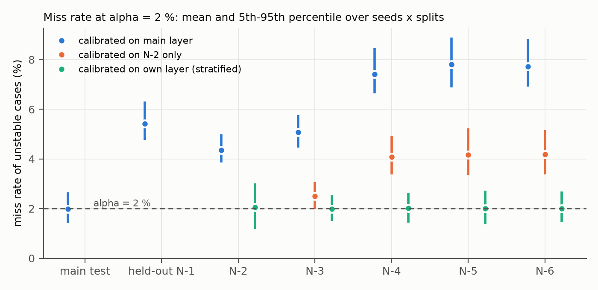
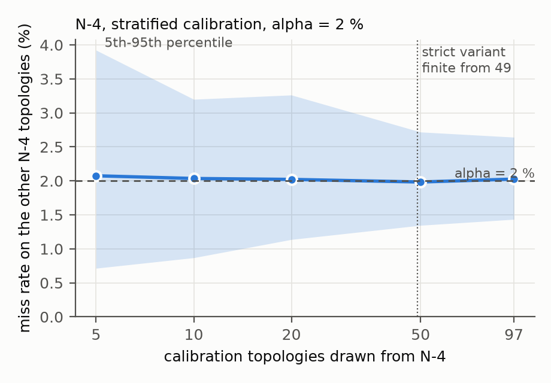
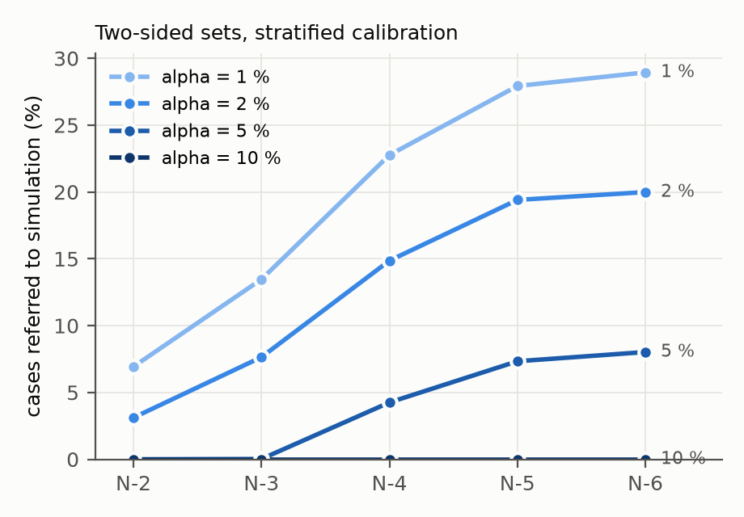

# tsa-conformal: detailed results

The one-page summary is in the [README](../README.md). This file gives the full motivation, data, method and results behind it.

A transient stability classifier is usually deployed with a threshold chosen on held-out data so that at most 2 % of the unstable cases are missed. That rule is class-conditional split conformal prediction on the unstable class. Its miss-rate statement therefore holds for new cases that are exchangeable with the calibration cases, and only for those. This repository measures the statement on the IEEE 39-bus system with a set-based generator response model [2] and test layers with up to six line outages.

The statement holds on the main layer: 1.97 % missed at α = 2 %. It fails on single-line-outage topologies left out of training (5.4 %) and on the N-4 to N-6 layers (7.4–7.8 %). Two remedies, following Alcántara & Chatzivasileiadis [1], each restore it at a measurable price. Calibrating on each layer brings the miss rate back to 2.0 %, but it needs labeled cases from that layer and raises false alarms to 17–24 %. Adding two-sided prediction sets keeps both error rates at about 2 % instead, and sends 15–20 % of the N-4 to N-6 cases to time-domain simulation. Kernel-weighted calibration on the model's own embedding, the second remedy in [1], does not help here: one lower threshold shared by all cases reaches the same miss rates with fewer false alarms. Missing PMUs behave differently from topology changes. They are observed at the decision, and calibrating for them only means masking the existing calibration cases, so recalibration restores the miss rate on the main layer without new simulation.

## Motivation

Alcántara & Chatzivasileiadis [1] add a conformal "trustworthiness layer" to a power-system foundation model for N-k contingency screening. The setting here differs from theirs in two ways:

1. **What is controlled.** Their layer gives marginal coverage of a regression output. For stability screening, the quantity that matters is the miss rate of unstable cases, which are the rare class. Calibrating on the unstable class only bounds that miss rate directly. The same threshold also follows from conformal risk control with the miss indicator as the loss [4].
2. **Where the calibration data come from.** Their stratified calibration has calibration cases for every N-k order. Here the comparison is between a calibration that has seen the target layer and one that has not, and the question is how many topologies of a layer the calibration needs.

## The observation

The paper's threshold rule [2] is: *on the validation set, take the highest threshold whose miss rate is at most 2 %*. This is a split conformal threshold on the unstable class:

- nonconformity score s = 1 − p, where p is the predicted probability of instability;
- q̂ = the ⌈(n+1)(1−α)⌉-th smallest score of the n unstable calibration cases;
- an alarm is raised when 1 − p ≤ q̂.

The two thresholds differ by at most one order statistic (`tests/test_conformal.py`). Read as conformal calibration, the paper's own numbers say where the statement holds and where it does not:

| test set | miss rate at the paper's 2 % threshold |
|---|---|
| main test (training topologies, new operating points) | 1.9 % |
| five N-1 topologies left out of training | 5.6 % (1.6 % for the model that saw them; Supplementary Table SXVI) |
| N-4 (new topologies, new operating points) | 7.2 % |

## Data

`data/` holds per-case scores only:

- **`scores_main.npz`**: 363,300 cases, five trained seeds. Covers the validation set, the main test set and the N-2 to N-6 layers.
- **`scores_holdout.npz`**: 135,600 cases, three seeds. Comes from the same model trained without five N-1 topologies (outaged lines 3, 4, 5, 7, 32).
- **`scores_missing.npz`**: the validation set, the main test set and N-4 (139,800 cases, five seeds), each under six persistent PMU losses. These are the first three random sets of three and of five missing generator PMUs from the model's robustness evaluation, exported by `tools/export_missing.py`.

Each case has:

- the predicted probability of instability for every seed;
- the label (240° rotor-angle separation within 10 s);
- the operating point and topology ids;
- the clearing time;
- the 240° crossing time;
- the simulator criterion violated first;
- the pre-fault angle spread.

The fields are documented in `src/tsa_conformal/data.py`. `embed_pca32_s0.npz` holds the model's mean-pooled token embedding for seed 0, which is the input of its final classifier. It is projected onto the first 32 principal components (99.7 % of the variance) by `tools/pca_embedding.py`, and its rows follow `scores_main.npz`.

| set | cases | operating points | topologies | unstable |
|---|---|---|---|---|
| validation | 40,800 | 2,040 | 34 | 17.7 % |
| main test | 40,800 | 2,040 | 34 | 16.9 % |
| N-2 / N-3 / N-4 | 59,700 / 58,800 / 58,200 | 30 per topology | 199 / 196 / 194 | 21–30 % |
| N-5 / N-6 | 55,500 / 49,500 | 30 per topology | 185 / 165 | 33–35 % |

The simulated dataset, the simulator and the model code are not part of this repository. `tools/export_scores.py` documents how the scores were exported from the trained checkpoints, with nothing retrained and no new simulation. It recomputes every probability and checks it against the stored per-case predictions (largest difference 5 × 10⁻⁷) or against the stored miss rates for N-5, N-6 and the held-out topologies. Its log is in `data/export_log.txt`.

## Method

`src/tsa_conformal/` is model-agnostic: it takes probabilities and labels only.

- **Alarm threshold** (`alarm_threshold`): conformal quantile on unstable cases, as above. With fewer than ⌈1/α⌉ − 1 calibration cases (49 at α = 2 %) the quantile is infinite and every case raises an alarm.
- **Two-sided prediction sets** (`prediction_sets`): the stable class gets its own threshold, calibrated on stable cases with score s = p. Each set is read as an operating decision:
  - {S}: declared stable.
  - {U}: alarm.
  - {S,U}: referred to time-domain simulation.
  - ∅: treated as an alarm.
- **Exchangeability unit.** Cases cluster: each main-layer operating point has 20 faults, and each N-k topology has 30 operating points with 10 faults each. Calibration / test splits are therefore drawn by operating point on the main layer and by topology in the N-k layers, with 50 random splits per seed (20 for A3).
- **Two calibration variants.** Using all cases of the calibration clusters gives an approximate statement. The *strict* variant takes one random unstable case per calibration cluster; that calibration set is exchangeable with one random case of a new cluster, which makes the finite-sample statement exact. Both are reported.
- **Calibration-conditional threshold** (`alarm_threshold_conditional`). The statements above hold on average over the calibration draw. The conditional version [7] bounds instead the probability that a single calibration ends above α: P(miss rate > α) ≤ δ. It places the threshold at the (c+1)-th smallest calibration value, where c is the largest count with P(Binomial(n, α) ≤ c) ≤ δ. It needs n ≥ log δ / log(1 − α) exchangeable values: 149 at α = 2 %, δ = 5 %.
- **Kernel-weighted threshold** (`kcp.py`, after [1], v2). Each unstable calibration case gets the weight exp(−d²/h²), where d is its distance to the test case in a scenario representation and h² is the squared distance of the 20th nearest case. The alarm threshold is the weighted quantile of the calibration probabilities. When the effective sample size falls below 5, the uniform threshold is used instead.
- **Uncertainty.** The spread over seeds and random splits is reported throughout. Miss rates on whole layers also get a topology-level bootstrap.

Every threshold, α and stratification is fixed on the calibration part; the test part is never used to choose anything.

## Results

All numbers below are generated by the scripts in `experiments/` and copied from `results/`. Headline table at α = 2 %: per seed, the mean over the random splits; then mean ± standard deviation over seeds (`results/headline.md`).

| evaluation set | miss, main-layer calibration | false alarm, main-layer calibration | miss, N-2 calibration | miss, own-layer calibration | false alarm, own-layer calibration | referred, two-sided, own layer |
|---|---|---|---|---|---|---|
| main test (other half) | 1.97 ± 0.07 | 1.62 ± 0.09 | – | – | – | – |
| held-out N-1 | 5.42 ± 0.35 | 1.78 ± 0.14 | – | – | – | – |
| N-2 | 4.35 ± 0.26 | 2.70 ± 0.08 | – | 2.06 ± 0.04 | 4.92 ± 0.19 | 3.11 ± 0.17 |
| N-3 | 5.08 ± 0.32 | 4.53 ± 0.15 | 2.51 ± 0.05 | 1.98 ± 0.06 | 9.53 ± 0.40 | 7.64 ± 0.20 |
| N-4 | 7.41 ± 0.47 | 6.36 ± 0.42 | 4.09 ± 0.14 | 2.03 ± 0.05 | 17.08 ± 0.51 | 14.86 ± 0.48 |
| N-5 | 7.80 ± 0.61 | 8.50 ± 0.62 | 4.18 ± 0.22 | 2.00 ± 0.04 | 22.52 ± 0.58 | 19.41 ± 0.35 |
| N-6 | 7.72 ± 0.51 | 9.03 ± 0.62 | 4.18 ± 0.17 | 2.01 ± 0.02 | 23.55 ± 0.68 | 19.99 ± 0.48 |

### A1. Main-layer calibration holds where it was calibrated and fails under topology shift

`experiments/a1_main_calibration.py` → `results/a1_summary.md`

- **Main test.** Calibrated on a random half of the main-test operating points, the miss rate on the other half is 0.96, 1.98, 4.99 and 9.99 % at α = 1, 2, 5 and 10 %.
- **Paper's validation set.** Calibrating on that set instead gives 1.87 % on the main test and 7.14 % on N-4. The paper's rule, at most one order statistic higher, reports 1.9 % and 7.2 %.
- **Held-out N-1.** One unseen line outage is already enough to break the statement: 5.4 % at α = 2 %.
- **N-k layers.** The excess grows with the outage order (4.4 % at N-2, 7.4–7.8 % at N-4 to N-6) and with α (18.8 % at N-4 for α = 10 %).
- **False alarms.** These rise too, from 1.6 % on the main test to 9.0 % at N-6. This is consistent with the lower AUC on these layers in [2]: the scores become less separable, not merely shifted.
- **Strict variant.** One case per operating point gives the same picture with a wider spread.

### A2. Calibrating on each layer restores the miss rate, at a cost in false alarms and data

`experiments/a2_stratified.py` → `results/a2_summary.md`

- **Miss rate.** Calibrating each layer on half of its topologies brings the miss rate on the other half back to 2.0 % in every layer, with a seed standard deviation ≤ 0.06 points.
- **Price in false alarms.** False alarms rise to 4.9 % (N-2), 17.1 % (N-4) and 23.6 % (N-6), against 2.7, 6.4 and 9.0 % with main-layer calibration.
- **Number of topologies.** The mean miss rate sits at α already with 5 calibration topologies (about 450 unstable cases at N-4). The spread over random draws, however, depends on the number of topologies rather than the number of cases. At N-4 the 5th–95th percentile range is 0.7–3.9 % with 5 topologies and 1.4–2.6 % with 97.

  
- **One calibration exceeds α about half the time.** At every m, about half of the single calibrations end above α. The statement is marginal over the calibration draw; A4 measures what a statement about a single calibration costs.
- **Strict variant.** It needs at least 49 calibration topologies with an unstable case at α = 2 %. With the 82–100 topologies available per layer, the quantile falls on the smallest or second-smallest per-topology value. The result is a miss rate of 0.8–1.0 % with 33–49 % false alarms at N-3 to N-6. For the second limitation of [1], this means a clean finite-sample statement per layer needs on the order of 50 labeled topologies of that layer at α = 2 %.
- **B1: calibrating on N-2 only** (half of its topologies). This gives 2.5 % at N-3 and 4.1–4.2 % at N-4 to N-6, with 8–15 % false alarms. It halves the excess of main-layer calibration but still exceeds α beyond N-3.

### A3. Two-sided sets turn the false-alarm cost into referrals to simulation

`experiments/a3_prediction_sets.py` → `results/a3_summary.md`

- **Main-layer calibration.** The stable threshold (p ≤ 0.17) and the alarm threshold (p ≥ 0.23) do not overlap at α = 2 %. Nothing is referred; cases in the gap form empty sets and raise alarms. The miss rate at N-4 remains 6.3 %.
- **Own-layer calibration.** At N-4 the alarm threshold drops to 0.05 and the stable threshold rises to 0.75. Both error rates stay at 2.0 % in every layer. The price is referring 3.1 % (N-2), 7.6 % (N-3), 14.9 % (N-4), 19.4 % (N-5) and 20.0 % (N-6) of all cases to simulation. At α = 5 % the referrals are 0, 0, 4.3, 7.3 and 8.0 %.

  
- **Which unstable cases are referred** (N-4, own-layer calibration, α = 2 %), grouped by lead time from the decision to the 240° crossing:

  | lead time | missed | referred | alarm |
  |---|---|---|---|
  | crossed within the input window | 0.0 % | 0.0 % | 100 % |
  | 0–0.5 s | 0.0 % | 0.9 % | 99.1 % |
  | 0.5–1 s | 0.8 % | 18.4 % | 80.8 % |
  | 1–3 s | 5.0 % | 31.0 % | 63.9 % |
  | > 3 s | 8.6 % | 53.0 % | 38.4 % |

  The referrals and the remaining misses are both late instabilities, and 51 % of the misses are voltage-first. This matches the boundary identified in [2]: late, partly voltage-driven instabilities. Whether a time-domain simulation finishes within that lead time is not evaluated here.

### A4. A single calibration, not the average over calibrations

`experiments/a4_calibration_conditional.py` → `results/a4_summary.md`

The calibration-conditional threshold is applied with δ = 5 %, using the same random splits as A1 and A2. Two quantities are reported: the share of single calibrations whose miss rate ends above α, and the price paid for lowering it (α = 2 %, five seeds × 50 splits):

| evaluation | calibration | values | P(miss > α) | miss | false alarm |
|---|---|---|---|---|---|
| main test | marginal, all faults of 1,020 points | 3,453 | 49 % | 2.00 % | 1.6 % |
| main test | conditional, all faults | 3,453 | 12 % | 1.63 % | 1.9 % |
| main test | conditional, one fault per point | 879 | 4 % | 1.21 % | 2.4 % |
| N-4 | marginal, all faults of 97 topologies | 8,766 | 49 % | 2.05 % | 17.1 % |
| N-4 | conditional, all faults of 97 topologies | 8,766 | 24 % | 1.80 % | 18.3 % |
| N-4 | conditional, one per topology, 97 topologies | 97 | – | 0 % | 100 % (no finite threshold) |
| N-4 | conditional, one per topology, 150 topologies | 150 | 6 % | 0.63 % | 52.3 % |

- **Main layer.** A single calibration can be made reliable at little cost. With one fault per operating point and the conditional threshold, 4 % of the calibrations end above α (5 % per operating point), and the false-alarm rate rises from 1.6 to 2.4 %.
- **Counting faults overstates the evidence.** Treating every fault as an independent calibration value gives a binomial margin that is too thin. With the conditional threshold, single calibrations still exceed α in 12 % of the draws on the main layer and in 18–36 % on the N-2 to N-6 layers. The faults of one operating point or topology are correlated, so the effective sample size is closer to the number of clusters.
- **Per N-k layer the reliable version is expensive.** At α = 2 % it needs at least 149 topologies of the layer, more than half of any layer here holds. With 150 calibration topologies, the share of single calibrations above α comes close to δ: 4–6 % for the per-topology miss rate, which is the quantity the statement refers to, and 3–8 % per case. The test part has only 15–49 topologies, so these shares carry about one point of evaluation noise. The threshold, however, lands on the smallest per-topology value: false alarms reach 24 % (N-2), 39 % (N-3), 52 % (N-4) and 58–59 % (N-5, N-6). At α = 5 % the same procedure costs 6–27 % false alarms, and at α = 10 % 2–13 %. For deep outage layers, a statement about one calibration is affordable only at a looser α.

### B3. Kernel-weighted calibration on the model's embedding is beaten by one lower threshold

`experiments/b3_kcp.py` → `results/b3_summary.md` (seed 0, five random splits, α = 2 %)

KCP is tested with two scenario representations:

- **Embedding.** The model's own embedding, which is available online from the PMU responses.
- **Topology.** The outage vector of the post-fault network, which, like own-layer calibration, needs the topology at the decision.

Every result is compared with a single threshold that gives the same miss rate.

- **Embedding, main-layer calibration.** KCP lowers the N-4 miss rate to 1.1 % without any N-4 data, but it alarms on 34 % of the stable main-test cases and 56 % of the stable N-4 cases. The threshold follows each case's own score. The reason is that the embedding nearly determines the score: two principal components carry 97.5 % of its variance. Localizing the unstable-class quantile in it therefore conditions on the score itself. In the regression setting of [1], the kernel acts on residuals, which the embedding does not determine.
- **It is dominated.** One threshold shared by all sets, placed to give KCP's N-4 miss rate, has fewer false alarms on N-4 and both fewer misses and fewer false alarms on the main test. Larger k_nn moves KCP toward a single threshold but never below it. With k_nn = 20, KCP's false-alarm rate on the main test also ranges from 19 to 54 % across the five calibration draws.

  | embedding KCP, main-layer calibration | main test: miss / false alarm | N-4: miss / false alarm | shared threshold | main test, shared | N-4, shared |
  |---|---|---|---|---|---|
  | k_nn = 20 (as in [1]) | 1.18 / 33.5 | 1.14 / 55.9 | p ≥ 0.045 | 0.13 / 7.1 | 1.14 / 22.1 |
  | k_nn = 100 | 1.39 / 8.6 | 1.87 / 25.8 | p ≥ 0.048 | 0.28 / 5.7 | 1.86 / 17.7 |
  | k_nn = 500 | 1.95 / 3.2 | 5.17 / 10.2 | p ≥ 0.124 | 1.00 / 2.7 | 5.17 / 8.8 |
  | k_nn = 2000 | 1.60 / 3.0 | 5.40 / 9.3 | p ≥ 0.134 | 1.10 / 2.6 | 5.39 / 8.4 |

- **Topology.**
  - *Main-layer calibration.* The outage kernel spreads its weight over the N-1 topologies and reproduces the single threshold: 7.47 % missed at N-4, against 7.43 %.
  - *All layers pooled, no layer labels.* The kernel localizes onto topologies with overlapping outages. At N-2 to N-6 it misses 1.8–2.9 % with 5.3–19.4 % false alarms. This is close to one threshold per layer (1.9–2.2 % missed, 5.1–22.8 % false alarms) and up to 0.4 points below the single-threshold reference at the same miss rate.
  - In effect, this is a soft form of stratification, and like stratification it needs the outages at the decision.
- **A practical reading.** For N-4 to N-6, own-layer calibration places the alarm threshold near p = 0.05 (A3). A single threshold at that level, applied to every case, needs neither the layer nor a kernel. It misses 0.3 % on the main test and 1.9 % at N-4, with 5.7 % and 17.7 % false alarms. Setting it still requires labeled cases from the deepest layer the operator wants covered.

### B2. Missing PMUs: observed at the decision, and calibrated without new simulation

`experiments/b2_missing_pmu.py` → `results/b2_summary.md` (five seeds × 20 splits, α = 2 %)

A missing PMU delivers nothing: the generator's channels are zero for every case, as in the robustness evaluation of [2]. The threshold is either kept as calibrated without missing PMUs, or recalibrated on a random half of the main-test operating points under the same missing PMUs. Recalibrating on the validation set under the same missing PMUs, as the paper does, gives similar N-4 numbers here: 5.5–7.4 % missed, 8.6–47 % false alarms. The paper's Supplementary Table SXIX, with three seeds and its own threshold rule, reports 5.7–7.9 % and 8.0–46.8 %.

| missing generators | main: miss, as deployed | main, recalibrated: false alarm | main, two-sided: referred | N-4: miss, recalibrated on main | N-4 own layer: false alarm | N-4 own layer, two-sided: referred |
|---|---|---|---|---|---|---|
| none | 2.03 | 1.60 | 0.00 | 7.44 | 17.3 | 14.9 |
| {0, 4, 7} | 2.20 | 2.55 | 0.60 | 6.69 | 22.7 | 19.7 |
| {1, 4, 6} | 2.73 | 2.73 | 0.83 | 7.13 | 22.2 | 19.2 |
| {2, 7, 8} | 3.29 | 4.51 | 2.57 | 6.50 | 29.8 | 25.7 |
| {0, 1, 2, 4, 9} | 15.37 | 28.95 | 24.96 | 6.14 | 71.2 | 61.4 |
| {2, 3, 4, 6, 9} | 4.96 | 5.73 | 3.82 | 5.47 | 32.2 | 28.3 |
| {0, 1, 6, 7, 8} | 4.34 | 8.66 | 6.74 | 6.08 | 40.5 | 34.4 |

All values are %. Every recalibrated variant misses 2.0 % on the kind of cases it was calibrated for, and every two-sided variant also keeps false alarms there at 2.0 %.

- **Missing PMUs alone.** The threshold calibrated without missing PMUs misses 2.2–3.3 % with three PMUs missing and 4.3–15.4 % with five. Recalibrating under the same missing PMUs restores 2.0 % for every set. The false-alarm rate it costs grows with the information lost: 2.6–4.5 % with three missing PMUs, 5.7–29 % with five.
- **Two-sided sets.** These keep false alarms at 2.0 % and refer the difference to simulation. For example, with the worst set of five, the one-sided 29 % false alarms become 2 % false alarms plus 25 % referrals.
- **Both shifts at once.** Recalibrating on the main layer under missing PMUs does not touch the topology part: N-4 still misses 5.5–7.1 %, about what it misses without missing PMUs (7.4 %). The two shifts are separate, and the calibration data must contain both. With N-4 calibration data under the same missing PMUs, the miss rate is 2.0 %, at 22–71 % false alarms or 19–61 % referrals.
- **Why the two shifts differ in practice.** Which PMUs are missing is observed at the decision. Calibrating for a missing set needs no new simulation, only the existing calibration cases with the same channels zeroed. A calibration per missing set is therefore feasible online, while a calibration per topology needs both the topology and new simulated cases.

## Limitations

- **Scope.** One test system (IEEE 39-bus), one simulator and one model architecture (five seeds; three for the held-out N-1 model).
- **Best case for own-layer calibration.** Topologies within a layer are drawn at random by the same generator, so the per-layer calibration results are a best case. A real topology change is not a random draw from a known layer.
- **Correlated cases.** Faults on the same operating point or topology are correlated. The main results use all cases of the calibration clusters, so they are approximate; the strict variant is reported alongside.
- **Own-layer calibration needs the outage order.** Assigning a test case to its layer requires knowing, at the decision, how many lines are out. The model's input contract [2] does not assume this, because breaker states may arrive late or wrongly. A trust layer that stratifies by layer therefore reintroduces the topology dependency that the model avoids.
- **Labeled cases needed.** Own-layer calibration needs labeled, that is simulated, cases from the layer. This repository measures how many are needed but not how to obtain them online.
- **Marginal statement.** A1–A3 are marginal over the calibration draw: a single calibration exceeds α about half the time. The conditional version (A4) is exact only with one fault per cluster. Per N-k layer at α = 2 % it needs at least 149 of the layer's 165–199 topologies, and then raises false alarms to 24–59 %.
- **Referral not evaluated.** Referral assumes that time-domain simulation is available and returns in time.

## Future work

- A scenario representation that is available online but does not determine the score, or local recalibration of the probability of instability itself, as the localized counterpart of KCP for a classifier (B3).
- Adaptive conformal inference [6] for online topology changes.
- Cluster-aware calibration that uses all faults of a cluster without counting them as independent, for example the pooling methods for two-layer hierarchical data [8].
- The 118-bus system.

## References

[1] A. Alcántara and S. Chatzivasileiadis, "Trustworthiness layer for foundation models in power systems: Application to N-k contingency screening," arXiv:2602.07995, 2026.
[2] Y. Li, T. Xiao, S. Huang, and Y. Chen, "Transient stability assessment from generator-side PMU responses: A physically grounded set-based model and its applicability boundaries," under review at *IEEE Transactions on Power Systems*, 2026.
[3] V. Vovk, A. Gammerman, and G. Shafer, *Algorithmic Learning in a Random World*. Springer, 2005.
[4] A. N. Angelopoulos, S. Bates, A. Fisch, L. Lei, and T. Schuster, "Conformal risk control," in *Proc. ICLR*, 2024.
[5] J. Lei, M. G'Sell, A. Rinaldo, R. J. Tibshirani, and L. Wasserman, "Distribution-free predictive inference for regression," *J. Amer. Statist. Assoc.*, vol. 113, no. 523, pp. 1094–1111, 2018.
[6] I. Gibbs and E. Candès, "Adaptive conformal inference under distribution shift," in *Proc. NeurIPS*, 2021.
[7] V. Vovk, "Conditional validity of inductive conformal predictors," *Machine Learning*, 2013, doi:10.1007/s10994-013-5355-6.
[8] R. Dunn, L. Wasserman, and A. Ramdas, "Distribution-free prediction sets for two-layer hierarchical models," *J. Amer. Statist. Assoc.*, 2023, doi:10.1080/01621459.2022.2060112.
